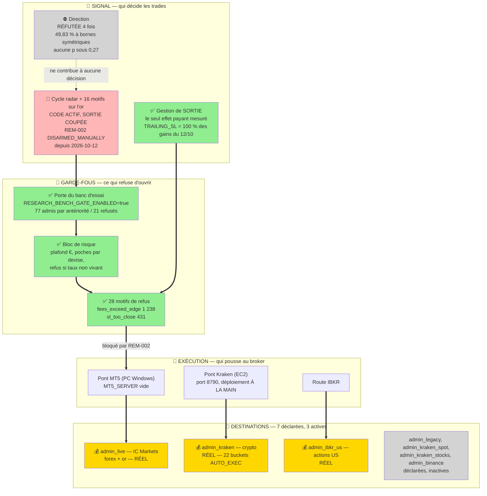

# Architecture — État actuel (source de vérité)

**Dernière mise à jour :** 2026-10-31
**Mainteneur :** mettre à jour à chaque transition (activation/désactivation d'une couche)

> Ce document décrit ce qui **tourne réellement en prod aujourd'hui**, pas ce qui
> existe dans le code. Si tu te demandes "on est sur quel système ?", la réponse
> est ici.

> ⚠️ **Récrit le 2026-10-31** (constat G-1 de l'audit du 2026-09-16). La version
> précédente datait du 2026-04-30 et décrivait une démo Pepperstone, un signal
> « V1 legacy », un bridge sur VPS Lightsail et un *gate S6* fixé au
> 2026-06-06 : **plus rien de cela n'était vrai**. Les paragraphes conservés
> sont ceux qui ont été revérifiés.

## TL;DR en une phrase

**Aujourd'hui, l'IA de trading est COUPÉE** (REM-002 `DISARMED_MANUALLY` depuis
le 2026-10-12). L'infrastructure est en **argent réel** sur trois destinations
— IC Markets via MT5, Kraken, IBKR — mais la liste blanche d'exécution ne
contient qu'**une seule paire, `XAU/USD`**, et aucun ordre automatique ne part
tant que REM-002 n'a pas été réarmé par une décision humaine nommée.

## Carte des 3 couches



**Légende :**
- 🟢 vert = actif et vérifié
- 🟡 jaune = destination en **argent réel**, joignable
- 🔴 rouge = code actif mais **sortie coupée**
- ⚪ gris = déclaré, pas en service

## Détail couche par couche

### Couche 1 — Signal (qui décide les trades)

| Système | Statut | Constat |
|---|---|---|
| **16 motifs sur l'or** | code actif, **sortie coupée** | produisent des setups ; aucun ne part (REM-002) |
| **Direction** | ⛔ **réfutée 4 fois** | radar seul (n=59, aucune p < 0,27) ; bornes symétriques (64 062 détections, 6 géométries, **49,83 %**) ; volatilité (ni quand, ni le sens) ; dollar/taux (information **entièrement contemporaine**) |
| **Gestion de sortie** | ✅ **le seul effet payant** | le 2026-10-12, `TRAILING_SL` : n=108, **+64,02 €**, soit **100 % des gains** |
| **Traînage indexé sur le spread** | ✅ armé (`0e8a1ae`) | le spread n'agissait auparavant que sur le déclenchement |
| **Plancher du stop indexé sur le spread** (k=2) | ✅ retenu | banc apparié 3,3 M ticks / 15 j : pire jour −0,151 → −0,129 |
| **ML** | ❌ jamais activé | AUC 0,526 |

**Ce qui se passe concrètement** : le cycle radar calcule les setups et les
insère en base. La chaîne de portes les évalue, et **la sortie est fermée** au
niveau REM-002. Les setups continuent donc d'être **journalisés** sans être
exécutés — ce qui est la situation voulue.

### Couche 2 — Garde-fous (ce qui refuse d'ouvrir)

| Garde-fou | Réglage | Effet mesuré |
|---|---|---|
| **Porte du banc d'essai** | `RESEARCH_BENCH_GATE_ENABLED=true` | sur 98 buckets : **77 admis** (tous par la clause d'antériorité du 2026-08-25), **21 refusés** — aucun des 21 n'est en `AUTO_EXEC` |
| **Bloc de risque** | plafond €, poches par devise, métaux séparés | refuse explicitement quand le taux n'est pas vivant |
| **`fees_exceed_edge`** | plancher **13,83 $** = prix/300 | **1 238 refus** — c'est lui qui interdit un départ à 9 € |
| **`sl_too_close`** | stop ≥ **0,05 %** = 2,075 $ | **431 refus** |
| **Pause après rafale de stops** | `RAFALE_AUTO_PAUSE_ENABLED=false` | ⛔ **désarmée** par Xavier le 2026-10-12 |

🔑 **Ces garde-fous bloquent l'OUVERTURE.** Aucun ne gère une position déjà
ouverte — c'est la gestion de sortie qui s'en charge.

### Couche 3 — Exécution et destinations

| Destination | Courtier | Argent | Statut |
|---|---|---|---|
| `admin_live` | **IC Markets** via MT5 | réel | active — forex et or |
| `admin_kraken` | **Kraken** | réel | active — **22 buckets `AUTO_EXEC`** |
| `admin_ibkr_us` | **IBKR** | réel | active — actions américaines |
| `admin_legacy` | ancienne route MT5 | réel | inactive |
| `admin_kraken_spot`, `admin_kraken_stocks`, `admin_binance` | — | — | déclarées, jamais mises en service |

Le registre (`backend/services/destinations_registry.py`) en déclare **7** ;
**3 sont actives**.

🔑 **Le registre déclare, le `BridgeConfig` décide.** Une destination déclarée
n'est pas joignable d'office, et une destination joignable n'a pas ses filtres
armés d'office. C'est ce décalage qui a laissé `admin_kraken` pousser en argent
réel **sans filtre de paires** jusqu'au 2026-10-30 (`fb8b283`) : la liste
blanche existait mais était gardée par `bridge_type == "mt5"`.

### Ce qui limite l'exposition réelle, concrètement

```
MT5_BRIDGE_LIVE_WHITELIST_PAIRS=XAU/USD
MT5_BRIDGE_ALLOWED_ASSET_CLASSES=forex,metal,energy,crypto
WATCHED_PAIRS=<25 paires>
```

- **`WATCHED_PAIRS` est l'univers OBSERVÉ** (25 paires), pas l'univers tradé.
- **La classe d'actif autorise large**, mais
- **la liste blanche ne laisse passer que `XAU/USD`** depuis le 2026-10-08.
  Donc IBKR, l'énergie et les indices **ne partent pas en réel**.

### 🛑 L'interrupteur général

**REM-002 `DISARMED_MANUALLY` depuis le 2026-10-12.** Décision de Xavier après
une journée à **−38,31 €** : « j'ai perdu assez d'argent aujourd'hui ».
`MT5_SERVER` est vide.

⛔ **Le réarmement demande une décision humaine explicitement nommée.**

Vérifier avec la skill `or-etat`, qui contrôle les **trois voies d'ordre** —
un seul drapeau vert ne prouve pas que les trois sont fermées.

## Comment vérifier ce qui tourne en live (commandes)

```bash
# 0. Est-ce armé ? La seule réponse qui vaut : les TROIS voies
#    (skill or-etat ; un drapeau isolé ne prouve rien)

# 1. Accès à l'hôte — la clé est DANS le dépôt, à la racine
ssh -i scalping-key.pem ec2-user@13.63.77.180

# 2. Les réglages qui limitent l'exposition (noms de clés, pas de secrets)
sudo grep -E '^(MT5_BRIDGE_LIVE_WHITELIST_PAIRS|MT5_BRIDGE_ALLOWED_ASSET_CLASSES|RESEARCH_BENCH_GATE_ENABLED|MT5_SERVER)=' /opt/scalping/.env

# 3. Un setup passerait-il ? Ne PAS deviner : rejouer les ~30 portes réelles
#    (skill or-porte, par destination)

# 4. La configuration est-elle saine ?
#    (skill or-politique : refuse une destination en réel sans filtre de paires)

# 5. Déploiement — le script documente lui-même cette surcharge
SCALPING_HOST=ec2-user@13.63.77.180 bash deploy-v2.sh
```

⚠️ **Pièges de déploiement vérifiés :**
- un script de `/opt/scalping/jobs/` **écrase celui de l'image à chaque
  minute** — un rebuild ne le déploie donc pas ;
- le **pont Kraken se déploie à la main** (`/opt/kraken-bridge/bridge.py`,
  root:root 644, `kraken-bridge.service`, port 8790 vu comme
  `172.17.0.1:8790` du conteneur) : CRLF→LF, scp, `py_compile` avec
  `/opt/kraken-bridge/venv/bin/python`, `sudo install`, redémarrage — **un
  geste à la fois**, un script `sudo` composé est refusé ;
- le décalage horaire du pont est **déterministe** :
  `-decalage_serveur_sec/60 + 180`, **à soustraire** (21 j/21, 154 ancres).

## Dettes connues au 2026-10-31

| Dette | État |
|---|---|
| Le pont Kraken ne publie pas ses `garde_fous` indépendamment | ouverte |
| Le **markup hors de l'or est inconnu** | ouverte — à établir **avant** tout niveau absolu ; sur l'or il valait **10 points** entre les deux routes du pont |
| `RESEARCH_BENCH_GATE_ENABLED` est posé **deux fois** dans le `.env` de prod | ouverte — valeurs concordantes, donc sans effet, mais piège pour le prochain |
| `"EUR/USD` et `LINK/USD"` (guillemets collés) dans la table d'admission | ouverte — 2 lignes chacune, écrites le 2026-08-23, toutes deux en TELEGRAM donc inoffensives ; `WATCHED_PAIRS` est propre |
| Banc prospectif hors échantillon du 13 novembre | pré-inscrit (`4359c74`), reste à écrire |
| **R-27** : la suite ne rend pas deux fois le même verdict | ouverte — voir les règles non négociables de `CLAUDE.md` |

Pour le détail d'un trade de bout en bout :
[`cycle-de-vie-d-un-trade-or.md`](cycle-de-vie-d-un-trade-or.md).
Pour les règles de travail : [`../CLAUDE.md`](../CLAUDE.md).
