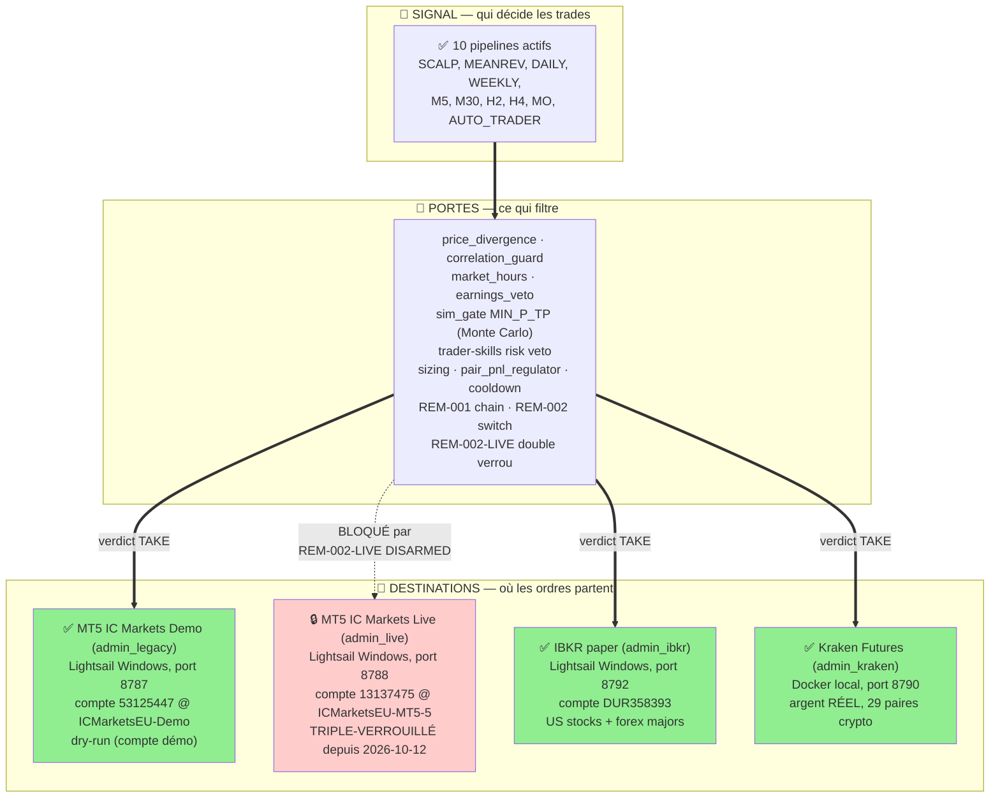

# Architecture — État actuel (source de vérité)

**Dernière mise à jour :** 2026-11-15
**Mainteneur :** mettre à jour à chaque transition (activation/désactivation d'une couche)

> Ce document décrit ce qui **tourne réellement en prod aujourd'hui**, pas ce qui
> existe dans le code. Si tu te demandes "on est sur quel système ?", la réponse
> est ici.

## TL;DR en une phrase

**Aujourd'hui, le radar envoie des ordres réels sur 3 destinations : IC Markets MT5
demo (forex/métaux/énergie dry-run), Kraken Futures live (crypto argent réel) et
IBKR paper (US stocks + forex, simulation).** IC Markets MT5 live est triple-verrouillé
depuis l'audit −1046 EUR du 2026-10-12.

## Carte des destinations actives

## Destinations — détails

### MT5 IC Markets Demo (admin_legacy)

- **Rôle** : dry-run multi-pipelines sur forex, métaux, énergie, crypto
- **Hôte** : Lightsail Windows (IP Tailscale `100.74.160.72`)
- **Port** : 8787
- **Compte** : `53125447 @ ICMarketsEU-Demo`
- **Scheduled Tasks** : `ScalpingMT5_Demo` (terminal) + `ScalpingBridge` (Python)
- **Classes d'actif** : `forex, metal, energy, crypto`
- **Pipelines qui y poussent** : les 9 pipelines MT5 (SCALP, MEANREV, DAILY, WEEKLY, M5, M30, H2, H4, MO)

### MT5 IC Markets Live (admin_live) — 🔒 VERROUILLÉ

- **Rôle** : argent RÉEL IC Markets EU, actuellement bloqué
- **Hôte** : Lightsail Windows (même machine que le demo)
- **Port** : 8788
- **Compte** : `13137475 @ ICMarketsEU-MT5-5`
- **Triple verrou actif** :
  1. `MT5_BRIDGE_LIVE_ENABLED=false`
  2. REM-002-LIVE DISARMED (double verrou code)
  3. `LIVE_ACCOUNT_BLOCKED_PAIRS = {XAG/USD}` (blocklist statique)
- **Raison** : audit −1046 EUR du 2026-10-12 (−732 EUR sur XAG/USD seul). Arrêt demandé par Xavier : « couper l'IA qui trade, j'ai perdu assez d'argent aujourd'hui ».
- **Réarmement** : décision explicite de Xavier, pas automatique.

### IBKR paper (admin_ibkr)

- **Rôle** : simulation US stocks + forex majors
- **Hôte** : Lightsail Windows (même machine)
- **Port** : 8792 (bridge Python + Gateway IBKR auto-login via IBC)
- **Compte** : `DUR358393` (paper trading)
- **Scheduled Task** : `IBKR Bridge Autostart`
- **Pipelines qui y poussent** : `auto_trader` (US stocks + forex majors)
- **Watchdog** : `ibkr_gateway_watchdog` (poll 5 min, alerte Telegram infra)

### Kraken Futures (admin_kraken) — 💰 ARGENT RÉEL

- **Rôle** : trading crypto réel, régulé EU
- **Hôte** : Docker local sur EC2 (port 8790)
- **Compte** : argent réel, 29 paires whitelist (`KRAKEN_BRIDGE_ALLOWED_HORIZONS=*`, tous horizons)
- **Pipelines qui y poussent** : signaux crypto routés dynamiquement
- **Garde-fou** : `kraken_sltp_guard` (positions nues auto-protect)
- **Reconciliation** : `kraken_sync` toutes les 120 s (via `order_id` + `realized_pnl` exacts)
- **Watchdog** : `kraken_bridge_watchdog` (poll 5 min)

## Watchdogs parallèles

| Watchdog | Fréquence | Rôle |
|---|---|---|
| `ibkr_gateway_watchdog` | 5 min | Alerte Telegram si bridge IBKR DOWN |
| `kraken_bridge_watchdog` | 5 min | Alerte Telegram si bridge Kraken DOWN |
| `real_account_watchdog` | quotidien 22:03 UTC | Recap solde compte réel (MT5 live) |
| `mt5_sync` | 15 s | Reconciliation positions MT5 demo + live |
| `positions_watcher` | 30 s | Positions IBKR + sorties temporelles auto_trader |
| `echelle_stop_boucle` | 1 s | Stop ladder XAU/USD |
| `correlation_guard` | à l'ouverture | Vérifie corrélation avant chaque trade |

## Abandons définitifs

### Pepperstone (abandonné 2026-11-15)

- MT5 Terminal désinstallé de Lightsail Windows
- Scheduled Task `ScalpingMT5` supprimée
- Scripts `relancer_terminal_demo.sh` supprimés
- Docs `pepperstone-migration.md`, `onboarding-cedric-bridge.md` supprimés
- Infra multi-tenant Cedric supprimée (plus de clients)

### Binance (abandonné 2026-11-15)

- Destination `admin_binance` supprimée du registre
- 13 fichiers `backend/services/binance_*.py` supprimés
- 2 scripts (`binance_pnl_summary.py`, `rattrapage_crypto.py`) supprimés
- 7 consommateurs nettoyés (analysis_engine, mt5_bridge, scheduler, ml_features, ml_trading, price_service, shadow_reconciliation)
- 10 variables `BINANCE_*` supprimées de `config/settings.py`
- Flux crypto routé exclusivement via Kraken
- Raison : blocker AMF France sur Binance Futures

## Enveloppe technique

- **Radar** : conteneur Docker `scalping-radar` sur EC2 (eu-north-1), image `scalping-radar:latest`
- **REM-002 (fingerprint current)** : mis à jour à chaque déploiement, visible via `execution_allowed()`
- **DB** : SQLite `/app/data/trades.db` (mounted volume `/opt/scalping/data`)
- **Déploiement** : `bash deploy-v2.sh` depuis Git Bash (user Windows)
- **Config prod** : `/opt/scalping/.env` sur EC2 (non versionné)

## Historique des grandes migrations

| Date | Changement |
|---|---|
| 2026-04-30 | V1 scoring + Pepperstone démo + EA MQL5 (archive) |
| 2026-08-02 | Ajout Kraken Futures (réponse blocker AMF Binance) |
| 2026-08-04 | Audit multi-destination : IBKR + bridge Python |
| 2026-10-12 | **Audit −1046 EUR + arrêt live MT5** |
| 2026-10-xx | Abandon Pepperstone, migration IC Markets Demo |
| 2026-11-14 | Triple verrou REM-002-LIVE + XAG blocklist |
| 2026-11-15 | **Grand nettoyage** : Pepperstone désinstallé, Binance totalement purgé (code, services, settings, scripts), 10 pipelines calibrés avec sim_gate Monte Carlo |
